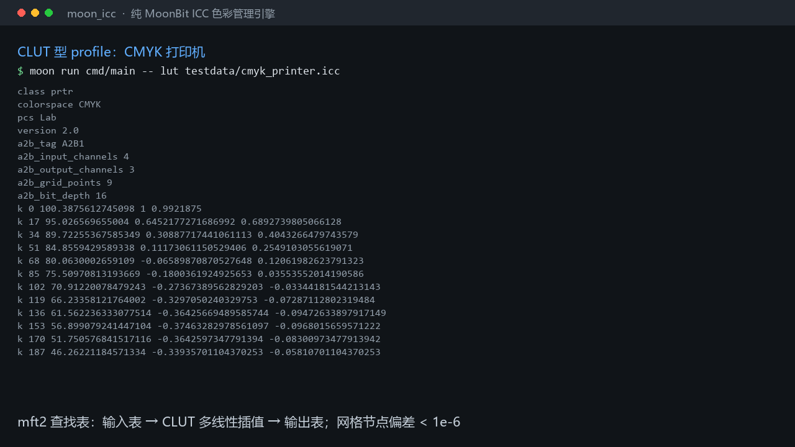

# moon_icc

纯 MoonBit 实现的 **ICC 色彩管理引擎**：解析 ICC profile 并执行真实色空间变换，不依赖任何 C 库或系统色彩管理系统。

[](https://github.com/LL728/moon_icc/actions/workflows/ci.yml)



▶ **[演示视频（39 秒，1280×720）](demo/moon_icc-demo.mp4)** —
视频里的每一行都是当场运行 `moon run cmd/main` 四个子命令的真实输出，
不是摆拍。可用 `python tools/make_demo_video.py` 重新生成。

## 这个库解决什么问题

MoonBit 生态里已有图像处理与渲染栈（图像编解码、2D 光栅化、PDF 读写、排版引擎），但**没有色彩管理**：它们可以解出像素、画出图形、排出页面，却无法回答一个基础问题——**这些 RGB 数值在目标设备上到底是什么颜色**。

具体缺口：

| 已有 | 缺什么 |
|---|---|
| 色彩空间数值转换（sRGB↔HSL↔XYZ） | 按 ICC profile 做**设备相关**变换 |
| 能解析 ICC profile 元数据的库 | 用 profile 做**实际色变换** |
| 图像编解码 | 图像进入/离开色彩工作流时的**色彩管理环节** |

`moon_icc` 补的是中间那一层：**读取 ICC profile，并真的按它做变换**——
从单个 profile 的色空间变换（设备编码值 ↔ PCS XYZ ↔ Lab），
到源设备到目标设备的完整色彩管理链路。

## 安装

```
moon add LL728/moon_icc
```

在 `moon.pkg` 中导入：

```
import {
  "LL728/moon_icc",
}
```

## 用法

### 解析 ICC profile

```moonbit
let data = @fs.read_file_to_bytes("sRGB Color Space Profile.icc")
let header = @moon_icc.parse_header(data)
println(header.device_class)   // "mntr"
println(header.color_space)    // "RGB "
println(header.pcs)            // "XYZ "
println(header.date_time.to_iso_string())  // "1998-02-09T06:49:00"

let tags = @moon_icc.parse_tag_table(data, header)
for tag in tags {
  println("\{tag.signature} 偏移=\{tag.offset} 长度=\{tag.size}")
}
```

### 变换到 PCS（XYZ / Lab）

```moonbit
let data = @fs.read_file_to_bytes("sRGB Color Space Profile.icc")
let profile = @moon_icc.Profile::parse(data)
let transform = profile.matrix_trc()

// sRGB 中灰 (0.5, 0.5, 0.5) → PCS XYZ
let xyz = transform.to_pcs(0.5, 0.5, 0.5)
// xyz = (0.20640003241890215, 0.21403939749252843, 0.17660683523992873)

// 再转到 Lab
let lab = @moon_icc.xyz_to_lab(xyz)
println(lab.l)  // 53.585...
```

### 源 profile → 目标 profile（多 profile 链接）

```moonbit
let src = @moon_icc.Profile::parse(@fs.read_file_to_bytes("sRGB Color Space Profile.icc"))
let dst = @moon_icc.Profile::parse(@fs.read_file_to_bytes("display.icc"))

// 媒体相对比色意图
let link = @moon_icc.ColorTransform::new(src, dst)
let (r, g, b) = link.transform(0.5, 0.5, 0.5)
```

### 跨类型链接（matrix/TRC ↔ LUT）

两侧各自可以是 matrix/TRC 型或 LUT 型，四种组合都支持——中间统一用
PCS XYZ 衔接。因此 **sRGB → CMYK 打印机**这样的跨类型链接可用：

```moonbit
let rgb = @moon_icc.Profile::parse(@fs.read_file_to_bytes("sRGB Color Space Profile.icc"))
let cmyk = @moon_icc.Profile::parse(@fs.read_file_to_bytes("printer.icc"))
let link = @moon_icc.ColorTransform::new(rgb, cmyk)

// 源 3 通道 → 目标 4 通道，用通道数无关的 transform_values
let out = link.transform_values([ 0.5, 0.5, 0.5 ])   // 4 个 CMYK 分量
```

`source_channels()` / `destination_channels()` 给出两侧的通道数，
由 profile 的色空间决定（RGB 为 3、CMYK 为 4）。

命令行等价形式：

```
moon run cmd/main --target wasm-gc -- link testdata/srgb.icc testdata/display.icc
moon run cmd/main --target wasm-gc -- link testdata/srgb.icc testdata/cmyk_printer.icc
```

输出首两行是两侧通道数，随后是 0..255 的灰阶映射（量化到 8 位），
每行 `link <输入> <输出通道...>`，可直接与 lcms2 之类的参考实现比对：

```
src_channels 3
dst_channels 3
link 0 0 0 0
link 1 9 9 9
...
```

CMYK 目标时输出 4 个分量：

```
src_channels 3
dst_channels 4
link 0 0 0 0 255
link 1 1 2 1 255
...
```
...
```

### 命令行示例

仓库自带一个可运行的示例程序：

```
moon run cmd/main --target wasm-gc -- parse testdata/srgb.icc
moon run cmd/main --target wasm-gc -- transform testdata/srgb.icc
moon run cmd/main --target wasm-gc -- link testdata/srgb.icc testdata/display.icc
moon run cmd/main --target wasm-gc -- link testdata/srgb.icc testdata/cmyk_printer.icc
moon run cmd/main --target wasm-gc -- link testdata/srgb.icc testdata/cmyk_printer.icc saturation
moon run cmd/main --target wasm-gc -- lut testdata/cmyk_printer.icc
```

`parse` 输出 profile 的头部与 tag 表：

```
size 3144
version 2.1
class mntr
colorspace RGB 
pcs XYZ 
datetime 1998-02-09T06:49:00
intent 0
illuminant 0.964202880859375 1 0.8249053955078125
tagcount 17
cprt 336 51
desc 388 108
wtpt 496 20
...
```

`transform` 输出固定样本点的变换结果（含中间调，便于对拍）：

```
sample 0.25 0.049063689759460294 0.050879655743278275 0.041981500061132944 ...
sample 0.5 0.20640003241890215 0.21403939749252843 0.17660683523992873 ...
sample 1 0.9642791748046875 0.999969482421875 0.8250885009765625 ...
```

## 当前进度

| 功能 | 状态 |
|---|---|
| ICC profile 二进制解析（头部 + tag 表，含边界校验） | ✅ 已完成并验证 |
| tag 数据解析（`XYZ ` / `curv` / `para`） | ✅ 已完成并验证 |
| matrix/TRC 类型 profile → PCS XYZ 变换 | ✅ 已完成并验证 |
| XYZ ↔ Lab 转换与 CIE76 色差 | ✅ 已完成并验证 |
| 逆变换（PCS XYZ → 设备 RGB）与矩阵求逆 | ✅ 已完成并验证 |
| 多 profile 链接（源设备 → PCS → 目标设备） | ✅ 已完成并验证 |
| 媒体相对比色意图 | ✅ 已完成并验证 |
| CLUT 型 profile 变换（`mft1` / `mft2`，CMYK 打印机等） | ✅ 已完成并验证 |
| 跨类型链接（matrix/TRC ↔ LUT 任意组合） | ✅ 已完成并验证 |
| 渲染意图：感知 / 媒体相对比色 / 饱和度 | ✅ 已完成并验证 |
| 渲染意图：绝对比色 | **已知限制**，见下文（与相对比色相同路径） |
| `mAB` / `mBA`（ICC v4 LUT） | 计划中 |
| PCS 为 `XYZ ` 的 LUT 型 profile | 计划中 |

## CLUT 型 profile 变换

大量真实世界的 profile（印刷、CMYK、扫描仪）不是矩阵/TRC 型，而是把整个
变换存在一张多维查找表里。本库支持 ICC v2 的两种 LUT 类型：

| 类型 | 名称 | 表值位深 |
|---|---|---|
| `mft1` | lut8Type | 8 位（表固定 256 项） |
| `mft2` | lut16Type | 16 位（表项数在文件里显式给出） |

处理顺序：**输入表 → 矩阵（仅 3 输入通道时）→ CLUT（多线性插值）→ 输出表**。

用法：

```moonbit
let profile = @moon_icc.Profile::parse(@fs.read_file_to_bytes("printer.icc"))
// 设备值按 profile 输入色空间的通道顺序给出，0..1
let lab = profile.device_to_lab(1, [ 0.0, 0.0, 0.0, 0.5 ])  // CMYK 50% 黑
```

命令行：

```
moon run cmd/main --target wasm-gc -- lut testdata/cmyk_printer.icc
```

### 实现中容易错的三处

**（一）`mft2` 的字段顺序：矩阵在前，表项数在后。**

矩阵在偏移 `12..47`（9 × s15Fixed16），输入/输出表项数在 `48..51`，
表数据从 `52` 开始。本项目最初按"表项数在 12..15、矩阵在 16..51"实现，
结果与该 tag 的声明长度差 2052 字节；改用正确顺序后
`52 + 4×256×2 + 9⁴×3×2 + 3×2×2 = 41478`，与声明长度**精确相等**，
且 12..47 处读到标准单位矩阵、48..51 处读到 256 与 2。

**（二）ICC v2 的 Lab 编码上限是 `0xFF00`，不是 `0xFFFF`。**

| 版本 | 位深 | L 满量程 | a/b 满量程 |
|---|---|---|---|
| v2 | 16 | `0xFF00` = 65280 | `0xFF00` |
| v2 | 8 | `0xFF` = 255 | `0xFF` |
| v4 | 16 | `0xFFFF` = 65535 | `0xFFFF` |

因此解码要同时知道位深与版本。另有一个陷阱：**不能在折算之后把结果夹到
1.0**——v2 的 profile 会合法地存到 `0xFFFF`（表示略高于 100 的 L）。
本项目最初正是这样写的，网格节点判据立刻抓到：期望 100.387561，实得 100。

**（三）意图到 tag 的映射：`A2B0`/`A2B1`/`A2B2` 是三个不同的表。**

| 意图 | 编号 | 设备→PCS | PCS→设备 |
|---|---|---|---|
| 感知 | 0 | `A2B0` | `B2A0` |
| 媒体相对比色 | 1 | `A2B1` | `B2A1` |
| 饱和度 | 2 | `A2B2` | `B2A2` |

本机 CMYK profile 的 A2B0 与 A2B1 逐字节比较有 **26539 处差异**，全在 CLUT 区。
若把相对比色误接到 A2B0，暗端会差约 5 个 L 单位。

**（四）输入表常常不是恒等，不能假定"节点索引/网格数"就落在节点上。**

实测该 profile 通道 0 在 v=0.75 处表值为 49151，而恒等应为 49344。
因此网格节点判据的输入必须**反解输入表**得到（见
`tools/gen_clut_golden.py`），否则测到的是节点之间的插值结果，
节点判据就失效了。

## 与 lcms2 的交叉核对（重要）

端到端链接结果与 **lcms2**（业界标准 CMM，经 Pillow 的 `ImageCms` 调用）
用 4096 个随机彩色样本交叉核对。判据是三条，均可证伪：

1. 完全一致率 **≥ 98%**（实测 **98.68%**）；
2. 最大偏差 **≤ 3 级**（8 位量化）；
3. **偏差 ≥2 级的通道，其 lcms2 输出必须 ≤ 8**——把成因钉在极暗区。

为什么不是零容差？追查后的结论是**差异来自 lcms2 一侧的两个已知特性**：

**（一）lcms2 默认走 CLUT 近似。** 它链接两个 profile 时会构建 3D CLUT
并插值（速度优先）。同一批样本实测：

| lcms2 flags | 与本库完全一致 | 最大偏差 |
|---|---|---|
| NONE（默认） | 3942/4096 | 4 级 |
| **NOOPTIMIZE** | **4042/4096** | 3 级 |
| FORCE_CLUT | 3370/4096 | **11 级** |

强制走 CLUT 会让一致率与最大偏差同时显著恶化——这直接证明默认路径的差异
来自 lcms2 自身的近似。金标因此取 `NOOPTIMIZE` 这条精确通路。

**（二）8 位量化边界与 16 位流水线分辨率。** lcms2 在 16 位域上传递中间值。
实测偏差分布：

| 偏差 | 例数 | 目标线性值范围 | lcms2 输出 |
|---|---|---|---|
| 1 级 | 39 | 1.9e-4 .. 9.5e-1（全范围） | 7 .. 248 |
| 2 级 | 9 | 6.7e-5 .. 1.8e-4（极暗） | 2 .. 6 |
| 3 级 | 6 | 8.7e-5 .. 1.2e-4（极暗） | 3 .. 4 |

即：±1 级是全范围的量化边界翻转；**≥2 级只出现在极暗区**——那里目标线性值
仅约 1e-4，在 16 位域只有 6~8 个量化级，lcms2 的输出本身就有数级不确定度，
而本库全程双精度。

**独立证据的另一条腿**：本库与"按 ICC 规范逐字转写的独立双精度实现"
（`tools/diff_oracle.py`）在全部样本上**逐位一致**，因此上面是交叉核对，
本库的正确性不单独依赖 lcms2。

复现全部数字：

```
python tools/gen_golden.py             # 生成链接金标（lcms2 NOOPTIMIZE）
python tools/gen_clut_golden.py        # 生成 CLUT 金标（网格节点 + lcms2）
python tools/gen_cross_link_golden.py  # 生成跨类型链接金标
python tools/gen_intent_golden.py      # 生成四种渲染意图金标
python tools/lcms2_flags_check.py      # 复现 flags 对比表
python tools/lcms2_deviation_report.py # 复现链接偏差分布表
python tools/lcms2_intent_check.py     # 复现"哪些 profile 能区分意图"
python tools/diff_oracle.py wasm-gc    # 独立 Python 规范实现差分
python tools/make_demo_video.py        # 重新生成演示视频
```

## 渲染意图

四种意图经 `ColorTransform::with_intent` 指定，命令行用意图名：

```
moon run cmd/main --target wasm-gc -- link testdata/srgb.icc testdata/cmyk_printer.icc saturation
```

| 编号 | 名称 | 命令行 | 对 LUT 型 profile 的效果 |
|---|---|---|---|
| 0 | 感知 | `perceptual` | 用 `A2B0`/`B2A0` |
| 1 | 媒体相对比色（默认） | `relative` | 用 `A2B1`/`B2A1` |
| 2 | 饱和度 | `saturation` | 用 `A2B2`/`B2A2` |
| 3 | 绝对比色 | `absolute` | **同 1（已知限制，见下）** |

非法名称会被拒绝并给出可选值，不静默回退到默认意图。

### matrix/TRC 型 profile 四种意图等价

这类 profile 只有一组矩阵与曲线，没有按意图分开的数据。这不是本库的省略：
实测 lcms2 对 sRGB → 显示器 这组 profile 对，四种意图给出**逐位相同**的结果
（复现：`python tools/lcms2_intent_check.py`）。

### 含多张 LUT 的 profile 意图确实可区分

以本机 CMYK 打印机 profile 为例，以媒体相对比色为基准，感知差 35 级、
饱和度差 255 级、绝对差 20 级。本库对 0/1/2 三种意图与 lcms2 交叉核对，
200 个随机 RGB 样本、8 位域下**最大偏差 ≤ 2 级、一致率 ≥ 60%**。

### 绝对比色是已知限制

绝对比色需要在 PCS 上做白点缩放。本项目按标准形式实现过
「源侧乘 `wtpt/D50`、目标侧乘 `D50/wtpt`」，实测与 lcms2 的偏差
**从 20 级恶化到 107 级**，说明该形式与参考实现的实际语义不符。

由于无法从可用材料确定参考实现的绝对比色语义，本库**不实现**它：
编号 3 走与相对比色相同的路径（与 lcms2 的差异 ≤ 20 级），并在测试中
显式断言「编号 3 与编号 1 逐点相同」。发布一个会把结果改坏的猜测实现，
比承认这项限制更糟。

## 变换顺序与白点（实现要点）

两处最容易错、且**只用端点测试发现不了**的地方：

### 1. TRC 必须先于矩阵

```
linear = TRC(encoded)     # 先线性化
XYZ    = M · linear       # 再乘矩阵
```

顺序颠倒时，白点 `(1,1,1)` 与黑点 `(0,0,0)` **仍然完全正确**——
只有中间调会错。因此测试必须包含中间调样本；
本项目实测：翻转顺序后白点与 D50 的色差达到 **17.3**，中间调用例全部变红。

### 2. PCS 是 D50，但不能自己再做一次色适应

sRGB 的**原生白点是 D65**，而 ICC 的 PCS 固定为 **D50**。
关键在于：sRGB profile 里的 `rXYZ/gXYZ/bXYZ` 矩阵列
**已经**是从 D65 经 Bradford 适应到 D50 的结果。

所以实现**不再做任何色适应**。实测 `(1,1,1)` 经变换得到
`(0.96428, 0.99997, 0.82509)`，与 D50 `(0.9642, 1.0, 0.8249)` 的色差 < 0.1；
若误再加一次适应，白点会明显偏离。

## 明确不做

以下内容**不在**本项目范围内，写在此处以免误用：

- **绝对比色的白点缩放**：编号 3 当前与媒体相对比色（编号 1）相同。本项目按标准形式实现过白点缩放，但实测与 lcms2 的偏差从 20 级恶化到 107 级，说明该形式与参考实现的语义不符；在无法确定参考语义前不发布猜测实现。详见上文「渲染意图」。
- **感知 / 饱和度意图的 gamut mapping**：本库通过选取 `A2B0`/`A2B2` 表来体现意图，与 lcms2 在这两种意图下交叉核对通过；但不自行做色域映射（映射规则由 profile 内的 LUT 承载）。
- **`mAB` / `mBA`**（ICC v4 的 lutAToBType / lutBToAType）：当前的 LUT 支持只覆盖 v2 的 `mft1` / `mft2`；遇到 v4 LUT 类型会返回 `BadTagData` 明确报错。
- **PCS 为 `XYZ ` 的 LUT 型 profile**：XYZ 的编码范围与 Lab 不同，尚未实现，会显式报错而非静默给出错误颜色。
- **黑点补偿（BPC）**：不做。
- **图像文件读写**（PNG / JPEG / TIFF）：本库只处理色彩数值，不碰图像容器。4 通道（CMYK）的求值本身已可用。
- **软打样、色貌模型**：不做。

## 设计要点

### 外部不可信输入

ICC profile 是外部文件，因此解析层不信任任何字段：

- 每一处读取都做边界检查，越界返回结构化错误而不是 panic；
- 头部声明的 `size` 若大于实际字节数会被拒绝（此后所有 tag 偏移都不可信）；
- 每个 tag 的 `offset + size` 必须落在文件范围内；
- tag 条目数必须能装进剩余空间，且乘法做了溢出检查。

错误类型是 `IccError`，含 `Truncated` / `BadSignature` / `SizeMismatch` / `TagOutOfBounds` / `BadTagTable` / `OutOfRange` 六种，均带定位信息。

### 大端序与定点数

ICC 规范（ISO 15076-1 / ICC.1）全程使用**大端序**，且大量使用 16.16 定点数（`s15Fixed16Number`）。定点转换集中在 `reader.mbt`，避免各处重复实现而产生精度偏差。

> 实测教训：用错误的字节序读 `sRGB Color Space Profile.icm`，会把 3144 字节读成 1208745984，且 `acsp` 签名读成乱码。

## 测试与验证

```
moon test --target wasm-gc     # 63 项测试
moon test --target js          # 同一套测试，js 后端
python tools/diff_oracle.py wasm-gc    # 外部 oracle 差分
python tools/diff_oracle.py js         # 同上，js 后端
```

判据分四层，独立性递增：

1. **合成字节流**：精确构造每个字段，验证解析逻辑本身（含畸形输入）；
2. **真实 profile**：用 Windows 系统自带的 3 个真实 profile，覆盖 matrix/TRC 型（sRGB）、真实显示器 profile、CMYK/LUT 型（打印机）；
3. **外部 oracle**：五个来源——
   - `tools/diff_oracle.py`：Python `struct` **独立**按规范解析并**独立重做** matrix/TRC 变换，与本库逐字段、逐样本比对；
   - `link_golden_wbtest.mbt`：lcms2 生成的 4096 个彩色样本金标（matrix/TRC → matrix/TRC）；
   - `clut_golden_wbtest.mbt`：625 个 CLUT 网格节点 + 300 个 lcms2 CMYK 样本；
   - `cross_link_golden_wbtest.mbt`：lcms2 生成的跨类型链接金标（sRGB ↔ CMYK 各 300 个随机样本）；
   - `intent_golden_wbtest.mbt`：lcms2 生成的四种渲染意图金标（200 个随机 RGB 样本，四意图共用输入）；
4. **网格节点**：CLUT 节点值不依赖插值细节，任何正确实现在节点上都必须
   返回存储值。这一层单独钉住**解析、索引步长、Lab 解码**。

**实测结果**：

- matrix/TRC 差分：3 个 profile × 15 个样本 × 3 个分量，**最大偏差 0.0（逐位一致）**，
  wasm-gc 与 js 双后端相同。容差因此设为 `1e-15`。
- 与 lcms2 交叉核对（matrix/TRC → matrix/TRC）：一致率 98.68%，判据见上文。
- CLUT 网格节点：625 个节点与独立解析的偏差 **< 1e-6**（金标精度上限）。
- CLUT 对 lcms2：**最大偏差恰为 1 级**（8 位），无 2 级及以上；
  L 通道平均有符号差 −0.11 级，即无系统性偏移。
- 跨类型链接对 lcms2（各 300 个随机样本，8 位域）：
  - sRGB → CMYK：完全一致 **297/300（99%）**，最大偏差 ≤ 2 级；
  - CMYK → sRGB：完全一致 173、差 1 级 125、差 2 级 2，最大偏差 2 级。
- 渲染意图对 lcms2（200 个随机样本，8 位域）：感知 / 相对比色 / 饱和度
  三种意图**最大偏差 ≤ 2 级、一致率 ≥ 60%**；绝对比色见上文「已知限制」。


**判据验证**（主动植入 bug 确认判据是活的，不是空转）：

| 植入的错误 | 单元测试反应 |
|---|---|
| `renderingIntent` 读取位置错位 | 3 项变红，外部差分 12 处不一致 |
| TRC 与矩阵顺序颠倒 | 5 项变红（白点偏离 D50 达 17.3 色差） |
| 矩阵求逆漏掉转置 | 5 项变红（lcms2 一致率跌到 0%） |
| CLUT 维度步长顺序写反 | **4 项变红**（节点偏差 91 个 L 单位，lcms2 差 93 级） |
| LUT 侧 PCS 不做 Lab↔XYZ 转换 | **2 项变红**（偏差 255 级，即完全错） |

矩阵求逆那条是开发中真实出现过的 bug：逆矩阵写成了转置，与 lcms2 在 8 位域上
最大差 **173/255**。**灰阶样本完全测不出它**（灰阶只走矩阵的对角路径），
是 4096 个**彩色**样本把它抓出来的——这正是金标必须用彩色随机样本的原因。

## 参考与移植说明

本项目为**原创实现**，按 ICC 规范（ISO 15076-1:2005 / ICC.1:2022，即 ICC Profile Format Specification）从零编写，不包含任何第三方代码。

实现过程中参考以下开源项目**理解算法与行为**（仅作对照，未复制代码）：

| 项目 | 语言 | 许可证 | 参考范围 |
|---|---|---|---|
| [Little-CMS (lcms2)](https://github.com/mm2/Little-CMS) | C | MIT | ICC 规范的工程化解读、tag 处理策略 |

> lcms2 采用 MIT 许可证，与本项目 Apache-2.0 兼容。本项目未链接、未编译、未复制其代码；如后续引入其任何代码，将按其许可证要求注明。

## 许可证

Apache-2.0，见 [LICENSE](LICENSE)。
